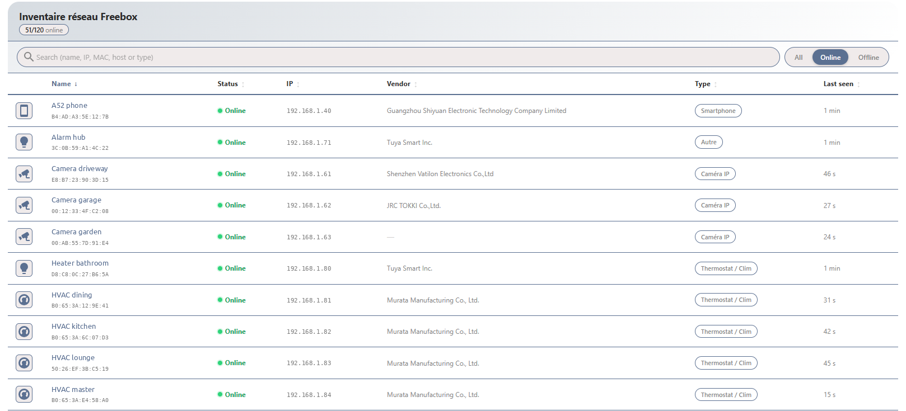

# Freebox Network Inventory Card

[](https://www.home-assistant.io/)
[](https://github.com/hacs/integration)
[](https://github.com/freddye83/freebox-network-inventory-card/releases)
[](LICENSE.txt)

> Lovelace card for the [Freebox Network Inventory](https://github.com/freddye83/freebox-network-inventory) integration.
> Interactive table of every network device detected by your Freebox — with DHCP static lease management.

🇫🇷 [Version française plus bas](#-version-française)



---

## Requirements

The [Freebox Network Inventory](https://github.com/freddye83/freebox-network-inventory) integration must be installed and configured.
Static lease features require integration **v1.2.0 or later**.

---

## Installation

### Home Assistant 2026.11 and later — Marketplace

Since 2026.11, HACS is built into Home Assistant as the **Marketplace**. Until this card is listed in the default catalog, add it as a custom repository:

1. Open **Settings → Marketplace**.
2. On first visit, read the community-content notice and select **I understand the risks and agree**.
3. Select **Add from link** and paste `https://github.com/freddye83/freebox-network-inventory-card`.
   Custom repositories require a GitHub connection: approve the device sign-in on GitHub when prompted.
4. Open **Freebox Network Inventory Card** and select **Install** — the dashboard resource is registered automatically.
5. Hard-refresh your browser (**Ctrl+Shift+R**).

[](https://my.home-assistant.io/redirect/hacs_repository/?owner=freddye83&repository=freebox-network-inventory-card&category=plugin)

> Already installed through HACS? Home Assistant migrates HACS to the Marketplace automatically on the first start after updating; the card stays installed and keeps receiving updates.

### Home Assistant before 2026.11 — HACS

1. Open **HACS**
2. **Frontend** → ⋮ menu → **Custom repositories**
3. URL: `https://github.com/freddye83/freebox-network-inventory-card` — Category: **Dashboard** (formerly *Plugin*) → **Add**
4. Search for **Freebox Network Inventory Card** and install it
5. Hard-refresh your browser (**Ctrl+Shift+R**)

### Manual installation

1. Download [`freebox-network-inventory-card.js`](https://github.com/freddye83/freebox-network-inventory-card/releases/latest)
2. Copy it to `/config/www/`
3. **Settings → Dashboards → ⋮ → Resources** → Add:
   - URL: `/local/freebox-network-inventory-card.js?v=2.13.0`
   - Type: **JavaScript module**
4. Hard-refresh your browser (**Ctrl+Shift+R**)

---

## Usage

```yaml
type: custom:freebox-network-inventory-card
title: Freebox network inventory
page_size: 20
default_filter: online
```

### Options

| Option | Type | Default | Description |
|---|---|---|---|
| `title` | string | `Freebox Network Inventory` | Card title |
| `page_size` | number | `10` | Devices per page |
| `default_filter` | string | `all` | Default filter: `all`, `online`, `offline`, `static` |

To display **only the static leases**:

```yaml
type: custom:freebox-network-inventory-card
title: Static DHCP leases
default_filter: static
page_size: 50
```

---

## Features

### Main table
- **Auto-detected icon** based on device type (TV, smartphone, NAS, ESP32…)
- **Online / offline indicator**
- **Persistent** column: whether the Freebox keeps the device in its inventory even when it is offline
- **Static lease indicator** next to the IP: 🔒 lease active, orange 🔒 the device still uses another IP until its next DHCP renewal
- **Filters**: All / Online / Offline / **Static**
- The **Static** filter also lists *orphan* leases (reserved MAC no longer seen by the Freebox), so you can clean them up
- **Real-time search** on name, IP, reserved IP, lease comment, MAC, vendor, type
- **Column sorting** (click on header) — numeric sort for IPs
- Configurable **pagination**
- Header counters: online / total / static leases

### Detail popup (click on the name)
- **Rename** → pushed to Freebox OS immediately
- **Change type** → pushed to Freebox OS immediately
- **DHCP static lease**: reserve an IP (current IP pre-filled), add a comment, update or delete the lease — the dynamic DHCP range is shown as a reminder, and Freebox errors are displayed inline
- All information: IPv4, IPv6, IP list, vendor, MAC, domain, access point, timestamps
- State flags: reachable, active, persistent, static lease

### Compatibility
- Light and dark themes
- Mobile friendly

---

## Example in a tabbed dashboard

```yaml
type: custom:tabbed-card
tabs:
  - card:
      type: custom:freebox-network-inventory-card
      title: Freebox network inventory
      page_size: 50
      default_filter: online
    attributes:
      label: Devices
  - card:
      type: custom:freebox-network-inventory-card
      title: Static DHCP leases
      page_size: 50
      default_filter: static
    attributes:
      label: Static leases
grid_options:
  columns: full
```

---

## License

MIT — see [LICENSE.txt](LICENSE.txt)

---
---

## 🇫🇷 Version française

> Carte Lovelace pour l'intégration [Freebox Network Inventory](https://github.com/freddye83/freebox-network-inventory).
> Tableau interactif de tous les équipements réseau détectés par la Freebox — avec gestion des baux DHCP statiques.

### Prérequis

L'intégration [Freebox Network Inventory](https://github.com/freddye83/freebox-network-inventory) doit être installée et configurée.
Les baux statiques nécessitent l'intégration **v1.2.0 ou ultérieure**.

### Installation

#### Home Assistant 2026.11 et ultérieur — Marketplace

Depuis la 2026.11, HACS est intégré à Home Assistant sous le nom de **Marketplace**. Tant que la carte n'est pas dans le catalogue par défaut, ajoutez-la comme dépôt personnalisé :

1. Ouvrez **Paramètres → Marketplace**.
2. À la première visite, validez l'avertissement sur le contenu communautaire (**I understand the risks and agree**).
3. Choisissez **Add from link** (« Ajouter depuis un lien ») et collez `https://github.com/freddye83/freebox-network-inventory-card`.
   Les dépôts personnalisés nécessitent une connexion GitHub : validez la connexion de l'appareil sur GitHub.
4. Ouvrez **Freebox Network Inventory Card** puis **Install** — la ressource du tableau de bord est ajoutée automatiquement.
5. Videz le cache du navigateur (**Ctrl+Maj+R**).

> Déjà installée via HACS ? La migration vers le Marketplace est automatique au premier démarrage après la mise à jour.

#### Home Assistant avant 2026.11 — HACS

1. Ouvrez **HACS**
2. **Frontend** → menu ⋮ → **Dépôts personnalisés**
3. URL : `https://github.com/freddye83/freebox-network-inventory-card` — Catégorie : **Dashboard** (anciennement *Plugin*) → **Ajouter**
4. Recherchez **Freebox Network Inventory Card** et installez
5. Videz le cache du navigateur (**Ctrl+Maj+R**)

#### Installation manuelle

1. Téléchargez [`freebox-network-inventory-card.js`](https://github.com/freddye83/freebox-network-inventory-card/releases/latest)
2. Copiez-le dans `/config/www/`
3. **Paramètres → Tableaux de bord → ⋮ → Ressources** → Ajouter :
   - URL : `/local/freebox-network-inventory-card.js?v=2.13.0`
   - Type : **Module JavaScript**
4. Videz le cache du navigateur (**Ctrl+Maj+R**)

### Options

| Option | Type | Défaut | Description |
|---|---|---|---|
| `title` | string | `Freebox Network Inventory` | Titre de la carte |
| `page_size` | number | `10` | Nombre d'appareils par page |
| `default_filter` | string | `all` | Filtre par défaut : `all`, `online`, `offline`, `static` |

Pour n'afficher **que les baux statiques** : `default_filter: static`.

### Fonctionnalités

**Tableau principal**
- Icône auto-détectée, indicateur en ligne / hors ligne
- Colonne **Persistent** : l'appareil est conservé dans l'inventaire de la Freebox même hors ligne
- **Indicateur de bail statique** à côté de l'IP : 🔒 bail actif, 🔒 orange l'appareil utilise encore une autre IP jusqu'au prochain renouvellement DHCP
- Filtres : Tous / En ligne / Hors ligne / **Static**
- Le filtre **Static** affiche aussi les baux *orphelins* (MAC réservée que la Freebox ne voit plus) pour faire le ménage
- Recherche en temps réel (nom, IP, IP réservée, commentaire du bail, MAC, fabricant, type)
- Tri par colonne (numérique pour les IP), pagination, compteurs dans l'en-tête

**Popup de détail (clic sur le nom)**
- Modification du nom et du type → répercutée sur Freebox OS
- **Bail DHCP statique** : réserver une IP (IP actuelle pré-remplie), ajouter un commentaire, modifier ou supprimer le bail ; la plage DHCP dynamique est rappelée et les erreurs de la Freebox s'affichent directement
- Toutes les informations : IPv4, IPv6, liste des IP, fabricant, MAC, domaine, point d'accès, horodatages
- Indicateurs : joignable, actif, persistant, bail statique

**Compatibilité** : thèmes clair et sombre, mobile.

### Licence

MIT — voir [LICENSE.txt](LICENSE.txt)
