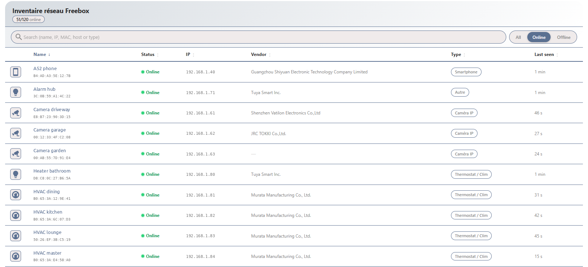

# Freebox Network Inventory Card

[](https://github.com/hacs/integration)
[](https://github.com/freddye83/freebox-network-inventory-card/releases)
[](LICENSE)

> Carte Lovelace pour l'intégration [Freebox Network Inventory](https://github.com/freddye83/freebox-network-inventory).  
> Tableau interactif de tous les équipements réseau détectés par la Freebox.



---

## Prérequis

L'intégration [Freebox Network Inventory](https://github.com/freddye83/freebox-network-inventory) doit être installée et configurée.

---

## Installation via HACS

1. Ouvrez **HACS** dans Home Assistant
2. **Frontend** → menu ⋮ → **Dépôts personnalisés**
3. URL : `https://github.com/freddye83/freebox-network-inventory-card`
4. Catégorie : **Plugin** → **Ajouter**
5. Recherchez **Freebox Network Inventory Card** et installez
6. Videz le cache navigateur (**Ctrl+Maj+R**)

## Installation manuelle

1. Téléchargez [`freebox-network-inventory-card.js`](https://github.com/freddye83/freebox-network-inventory-card/releases/latest)
2. Copiez dans `/config/www/`
3. **Paramètres → Tableaux de bord → Ressources** → Ajouter :
   - URL : `/local/freebox-network-inventory-card.js`
   - Type : **Module JavaScript**
4. Videz le cache navigateur (**Ctrl+Maj+R**)

---

## Utilisation

```yaml
type: custom:freebox-network-inventory-card
title: Inventaire réseau Freebox
page_size: 20
default_filter: online
```

### Options

| Option | Type | Défaut | Description |
|---|---|---|---|
| `title` | string | `Freebox Network Inventory` | Titre de la carte |
| `page_size` | number | `10` | Nombre d'appareils par page |
| `default_filter` | string | `all` | Filtre par défaut : `all`, `online`, `offline` |

---

## Fonctionnalités

### Tableau principal
- **Icône auto-détectée** selon le type d'appareil (TV, smartphone, NAS, ESP32...)
- **Indicateur en ligne / hors ligne** (point coloré)
- **Filtres** : Tous / En ligne / Hors ligne
- **Recherche** en temps réel sur nom, IP, MAC, fabricant, type
- **Tri par colonne** (clic sur l'en-tête) — tri numérique pour les IPs
- **Pagination** configurable
- **Compteurs** dans l'en-tête : en ligne / hors ligne / total

### Popup de détail (clic sur le nom)
- **Modification du nom** → répercutée immédiatement sur Freebox OS
- **Modification du type** → répercutée immédiatement sur Freebox OS
- Toutes les informations : IPv4, IPv6, liste des IPs, fabricant, MAC, domaine, point d'accès, timestamps
- Indicateurs d'état : joignable, actif, persistant

### Compatibilité
- Thème clair et sombre
- Compatible mobile

---

## Exemple dans un tableau de bord tabulé

```yaml
type: custom:tabbed-card
tabs:
  - card:
      type: custom:freebox-network-inventory-card
      title: Inventaire réseau Freebox
      page_size: 50
      default_filter: online
    attributes:
      label: DHCP Freebox
grid_options:
  columns: full
```

---

## Licence

MIT — voir [LICENSE](LICENSE)
